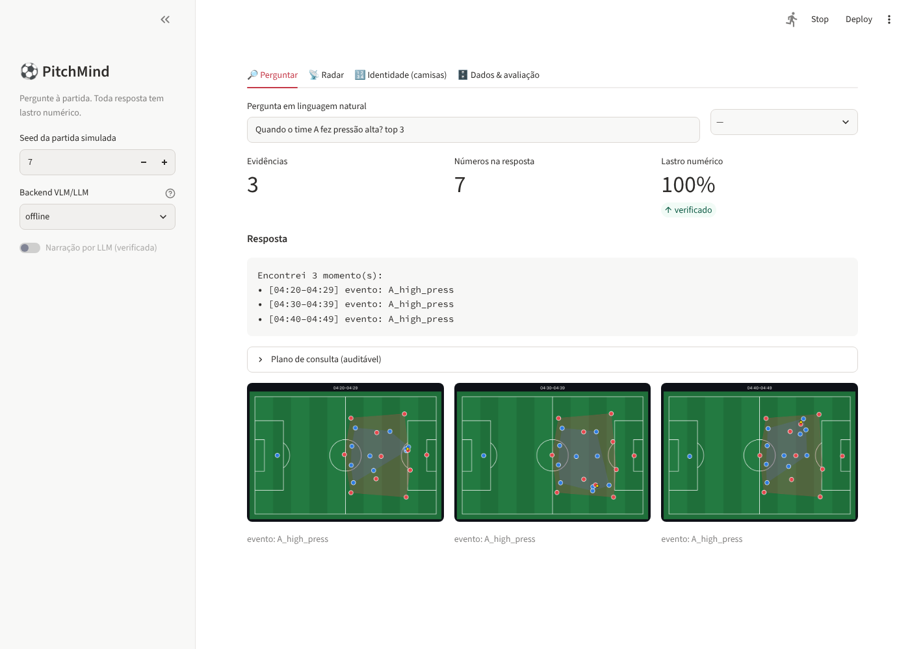
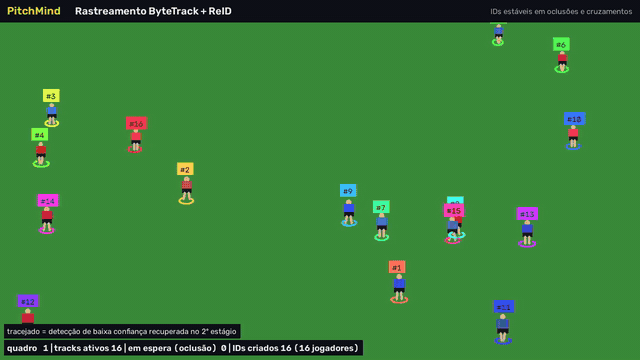
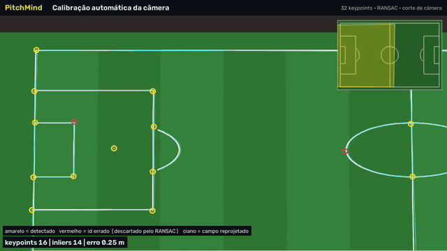
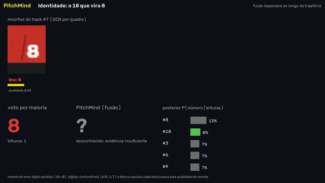
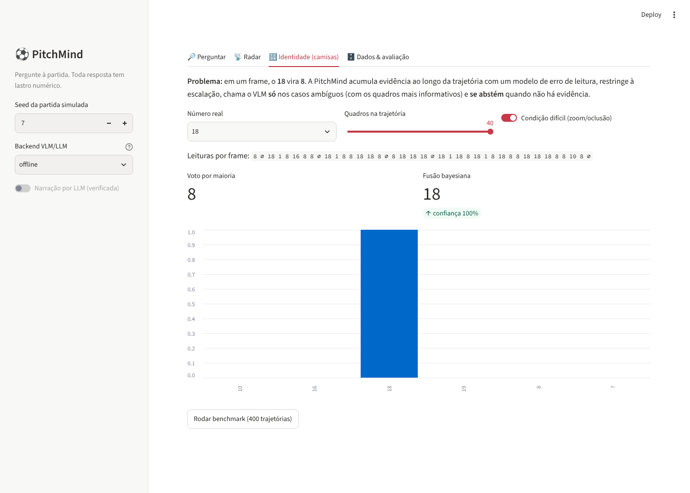

# ⚽ PitchMind: pergunte à partida

**ETL de tracking de futebol + RAG quantitativo verificado + identidade de camisas por fusão bayesiana com VLM.**

Inspirado no modo *Radar* do [Roboflow Sports](https://github.com/roboflow/sports) e na pergunta
*"até onde dá para chegar só com as imagens de uma transmissão?"*. A maior parte dos projetos para no radar,
o mapa tático com os pontos dos jogadores. O PitchMind continua a partir dele: você **faz perguntas em
português** sobre a partida e recebe respostas em que **cada número pode ser auditado**.


*Radar ao vivo: posições, compactação (área do bloco), rastro da bola, painel de métricas,
controle de campo em tempo real e eventos táticos detectados automaticamente
(gerado com `pitchmind animate`).*



## Demonstrações

Cada modo do pipeline tem um vídeo próprio. **Clique na prévia para abrir o MP4.**

| Rastreamento (ByteTrack + ReID) | Calibração automática da câmera |
|:---:|:---:|
| [](docs/media/tracking.mp4) | [](docs/media/calibration.mp4) |
| IDs estáveis em oclusões e cruzamentos; detecções de baixa confiança (tracejado) recuperadas no 2º estágio | 32 keypoints do campo + RANSAC; descarta ids errados (vermelho), detecta o **corte de câmera** e mostra no minimapa o que a câmera vê |
| **Identidade: o 18 que vira 8** | **Radar ao vivo** |
| [](docs/media/jersey.mp4) | [](docs/media/radar.mp4) |
| O voto por maioria erra (8); a fusão bayesiana começa em "?" e só afirma **18** quando a evidência é suficiente | Posições, compactação, métricas e controle de campo em tempo real, com eventos táticos detectados |

> Os vídeos usam cenas **sintéticas** geradas pelo próprio projeto, sem imagens de transmissão. Para
> gerá-los de novo: `pitchmind demos`.

## O que tem de novo

| # | Ideia | Por que importa |
|---|-------|-----------------|
| 1 | **RAG quantitativo** | A recuperação usa principalmente **predicados numéricos** (`A_pitch_control > 55`, z-score > 1,5σ, eventos, intervalo de tempo) sobre uma tabela DuckDB, e não apenas similaridade de embeddings. As legendas do VLM servem só para desempate. |
| 2 | **Verificador de lastro numérico** | Todo número da resposta precisa corresponder a um valor medido nas janelas de evidência, na precisão em que foi escrito. Quando um LLM narra a resposta e inventa um número, a narrativa é **descartada** e a resposta volta para a versão determinística. |
| 3 | **Plano de consulta auditável** | A pergunta vira um `QuantQuery` em JSON (filtros, ranking, eventos, tempo). Dá para ver exatamente *por que* cada momento foi escolhido. |
| 4 | **Identidade "18 ≠ 8" por fusão temporal** | Usa um modelo de erro de leitura explícito (dígito perdido, dígitos confundíveis), acumula evidência ao longo da trajetória e restringe o resultado à **escalação**. O VLM é chamado **só** nos casos ambíguos, com os *k* quadros mais informativos. Há também uma atribuição global (Hungarian) que impede números duplicados, e **abstenção** quando falta evidência. |
| 5 | **VLM como intérprete, nunca como fonte de números** | O VLM recebe as medições do tracking como contexto e descreve a cena. Os números vêm sempre da geometria. |

## Resultados (reproduzíveis com `pitchmind eval`)

**RAG quantitativo, precision@5 por fase tática** (ground truth do simulador):

| fase | a_high_press | b_high_press | a_low_block | a_counter | a_build_up | b_build_up | **média** |
|---|---|---|---|---|---|---|---|
| P@5 | 1,00 | 1,00 | 1,00 | 1,00 | 1,00 | 0,60 | **0,93** |

Esse resultado é da partida `--seed 7`. Nas seeds 1 e 2 a média cai para 0,83–0,87, sempre por causa de
`b_build_up`: a regra de "construção do time B" ainda é fraca e é o ponto de melhoria mais claro do RAG.

**Identidade de camisas**, 400 trajetórias simuladas (metade em condição difícil):

| método | acerto | **ID errada** | abstenção |
|---|---|---|---|
| voto por maioria (por frame) | 93,0% | **7,0%** | 0% |
| fusão bayesiana + escalação | 91,8% | **0,2%** | 8,0% |
| fusão + VLM só nas ambiguidades (8,0% dos tracks) | **99,5%** | **0,2%** | 0,3% |

> A métrica que importa é a **ID errada**. Em análise esportiva, atribuir uma ação ao jogador errado é pior
> do que dizer "não sei". A fusão reduz esse erro em cerca de 35× e chama o VLM em apenas 8% dos casos,
> o que mantém baixos o custo e a latência.

⚠️ **Limitações, com honestidade:** os números acima vêm de dados **simulados**: trajetórias táticas
sintéticas e um modelo de ruído de leitura de camisa. Eles validam a *lógica* do pipeline, mas não
substituem um benchmark em vídeo real (por exemplo, SoccerNet Jersey Number / Game State). O VLM do
benchmark também é simulado, com 90% de acerto.



## Arquitetura (ETL → RAG)

```
           EXTRACT                     TRANSFORM                          LOAD                 RAG / Q&A
 vídeo ─► YOLO/RF-DETR ─► times    ─► métricas por janela de 10s ─►  DuckDB `windows`  ─►  planner (regras | LLM JSON)
          (ou simulador)  (KMeans      bloco, linha, largura,          + índice TF-IDF        │
                           HSV)        compactação, pitch control,     das legendas           ▼
          homografia ───► campo (m)    posse, field tilt, pressão  ──────────────────►  retriever híbrido
                                       eventos por regras auditáveis                          │
          tracks + leituras de camisa  legenda VLM (números como contexto)                    ▼
              │                                                                        resposta determinística
              ▼                                                                         (+ narração LLM opcional)
     JerseyFuser: fusão bayesiana ─► VLM só se ambíguo ─► Hungarian ─► nº ou "?"              │
                                                                                             ▼
                                                                                   VERIFICADOR de lastro
```

```
pitchmind/
├── extract/   simulator.py (partida sintética com fases rotuladas) · video.py (YOLO + tracking + calibração)
├── transform/ features.py (métricas táticas) · events.py (pressão alta, bloco baixo, contra-ataque…)
├── load/      store.py (DuckDB + TF-IDF)
├── rag/       planner.py · retriever.py · verifier.py · engine.py
├── tracking/  tracker.py (ByteTrack + ReID) · sim.py (cenas com ground truth)
├── calibration/ keypoints.py (32 keypoints do campo, RANSAC, corte de câmera)
├── identity/  jersey.py (fusão bayesiana) · ocr.py (PARSeq, qualidade do recorte)
├── benchmarks/ soccernet.py (Jersey Number Recognition + exportação GSR)
├── vlm/       backends.py (Claude com visão + saída JSON estruturada | offline)
├── render/    radar.py · animate.py (radar ao vivo) · demos.py (vídeos de cada modo)
└── cli.py     app/streamlit_app.py
```

## Como rodar

```bash
pip install -e ".[app,dev]"
```

```bash
pitchmind --backend offline demo
```

```bash
pitchmind --backend offline eval
```

```bash
streamlit run app/streamlit_app.py
```

```bash
pitchmind --backend offline animate --start 240 --seconds 80 --out docs/img/live.gif
```

```bash
pitchmind demos --out docs/media
```

Perguntas que funcionam: *"Quando o time A fez pressão alta? top 3"*, *"Momentos em que o time B ficou
mais compacto"*, *"Qual a posse média do time A nos primeiros 5 minutos?"*, *"Compare a altura do bloco dos
dois times"*, *"controle de campo do time A acima de 55"*, *"bola mais rápida que o normal"*.

### Com VLM/LLM (opcional)

```bash
pip install -e ".[vlm]"
```

```bash
export ANTHROPIC_API_KEY=...
```

```bash
pitchmind --backend claude ask "Quando o time B pressionou alto?" --narrate
```

Com o backend `claude`, o planner passa a ser um LLM com saída JSON validada por schema, as janelas recebem
legenda visual e a narração final passa pelo verificador.

### Vídeo real (experimental)

```bash
pip install -e ".[video]"
```

```bash
pitchmind video jogo.mp4 --homography homografia.json --question "momentos de pressão alta"
```

Exemplo de `homografia.json`, com 4 ou mais pontos pixel→metro:
`{"image": [[x,y],...], "pitch": [[X,Y],...]}`.

## Rastreamento, calibração, SoccerNet e janelas por posse

Os quatro "próximos passos" da primeira versão já estão implementados e testados. Os números abaixo também
saem de `pitchmind eval`.

**1. Rastreamento ByteTrack + ReID → `JerseyFuser`** (`pitchmind/tracking/`, `pitchmind/identity/ocr.py`)

Kalman de velocidade constante, associação em dois estágios (ByteTrack: as detecções de baixa confiança
recuperam jogadores parcialmente ocluídos), custo IoU + aparência e re-identificação de tracks perdidos
(estilo BoT-SORT). Cada trajetória vira observações para a fusão de camisas: os recortes do tronco são
ordenados por qualidade (tamanho, nitidez, contraste), só os melhores passam pelo OCR (PARSeq via
`torch.hub`) e cada leitura entra na fusão com peso proporcional à qualidade.

| 3 cenas sintéticas, 14 jogadores, oclusões e cruzamentos | pureza de ID | IDs criados | trocas |
|---|---|---|---|
| ingênuo (só alta confiança, sem memória) | 0,540 | 62 | 52 |
| ByteTrack (2 estágios, só IoU) | 0,769 | 28 | 20 |
| **ByteTrack + ReID (PitchMind)** | **0,987** | **15** | **9** |

**2. Calibração automática de câmera** (`pitchmind/calibration/keypoints.py`)

Modelo métrico com os 32 keypoints do campo, homografia por RANSAC com checagens de sanidade (pontos
colineares, poucos inliers, erro de reprojeção em **metros**) e um `HomographyTracker` que suaviza H no
tempo, detecta **corte de câmera** e descarta quadros sem campo visível (close, replay). O detector de
keypoints é um YOLOv8-pose (`pitchmind video jogo.mp4 --field-model campo.pt`).

| 50 câmeras sintéticas, ruído de 2 px, 20% dos keypoints com id errado | resultado |
|---|---|
| calibradas | 48/50 (as 2 restantes foram **recusadas** por ter só 5 pontos visíveis) |
| erro médio de posição no campo | **0,19 m** (pior caso 0,42 m) |

**3. Benchmark SoccerNet** (`pitchmind/benchmarks/soccernet.py`)

- *Jersey Number Recognition*: lê o layout oficial (`<split>/images/<tracklet>/*.jpg` + `<split>_gt.json`)
  e compara, com o **mesmo** leitor, o voto por maioria e a fusão do PitchMind (escalação aberta 1–99,
  abstenção = `-1`, como na métrica oficial).

  ```bash
  pitchmind bench-jersey /dados/soccernet/jersey-2023 --split test
  ```

- *Game State Reconstruction*: `export_gsr_predictions` grava as predições no formato de submissão do
  `sn-gamestate` (chave `predictions`, `bbox_pitch` em metros com origem no centro, `attributes`
  role/jersey/team). O GS-HOTA deve ser calculado pelo avaliador **oficial**, não por uma reimplementação.

⚠️ O código e o formato estão testados com um mini-dataset no mesmo layout, mas **ainda não rodei o
benchmark no SoccerNet real**: os dados exigem cadastro (NDA) e os pesos do PARSeq/YOLO precisam de GPU
para rodar em tempo razoável. Quando houver números reais, eles entram aqui.

**4. Janelas adaptativas por posse** (`--windowing possession`)

As janelas cortam na troca de posse (suavizada por mediana móvel; bola ocluída não conta como troca). Posses
longas são divididas em pedaços de até 12 s, e disputas com menos de 3 s são fundidas à janela vizinha.

| 3 partidas simuladas | pureza de fase | janelas |
|---|---|---|
| fixas de 10 s | 0,948 | 60 |
| **adaptativas por posse** | **0,967** | **52** |

O ganho é real, mas pequeno: cada janela descreve melhor **uma** fase e o índice fica 13% menor. Já a
precision@5 do RAG fica igual nas duas opções, por isso o padrão continua sendo janelas fixas.

## Contribuidores

- **Sérgio Santana** ([@Sergiorsantana](https://github.com/Sergiorsantana)): idealização, arquitetura e desenvolvimento

Contribuições são bem-vindas: abra uma *issue* ou um *pull request*.

## Créditos

Inspirado em [Roboflow Sports](https://github.com/roboflow/sports) e nas discussões sobre VLMs aplicados
à análise esportiva. Licença MIT.
