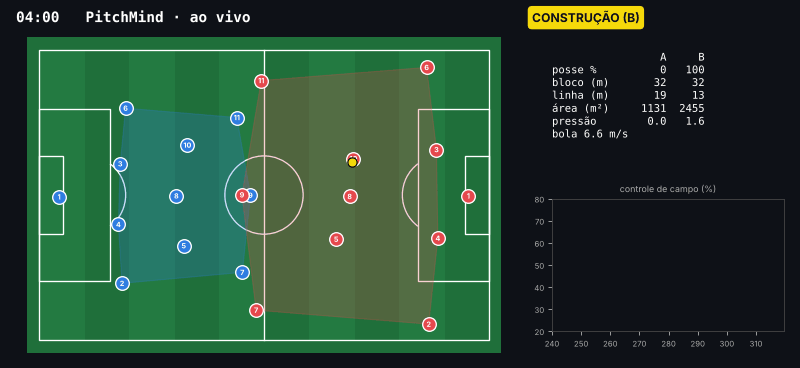

# ⚽ PitchMind: pergunte à partida

**ETL de tracking de futebol + RAG quantitativo verificado + identidade de camisas por fusão bayesiana com VLM.**

Inspirado no modo *Radar* do [Roboflow Sports](https://github.com/roboflow/sports) e na pergunta
*"até onde dá para chegar só com as imagens de uma transmissão?"*. A maior parte dos projetos para no radar,
o mapa tático com os pontos dos jogadores. O PitchMind continua a partir dele: você **faz perguntas em
português** sobre a partida e recebe respostas em que **cada número pode ser auditado**.



*Radar ao vivo: posições, compactação (área do bloco), rastro da bola, painel de métricas,
controle de campo em tempo real e eventos táticos detectados automaticamente
(gerado com `pitchmind animate`).*


## O que tem de novo

| # | Ideia | Por que importa |
|---|-------|-----------------|
| 1 | **RAG quantitativo** | A recuperação usa principalmente **predicados numéricos** (`A_pitch_control > 55`, z-score > 1,5σ, eventos, intervalo de tempo) sobre uma tabela DuckDB, e não apenas similaridade de embeddings. As legendas do VLM servem só para desempate. |
| 2 | **Verificador de lastro numérico** | Todo número da resposta precisa corresponder a um valor medido nas janelas de evidência, na precisão em que foi escrito. Quando um LLM narra a resposta e inventa um número, a narrativa é **descartada** e a resposta volta para a versão determinística. |
| 3 | **Plano de consulta auditável** | A pergunta vira um `QuantQuery` em JSON (filtros, ranking, eventos, tempo). Dá para ver exatamente *por que* cada momento foi escolhido. |
| 4 | **Identidade "18 ≠ 8" por fusão temporal** | Usa um modelo de erro de leitura explícito (dígito perdido, dígitos confundíveis), acumula evidência ao longo da trajetória e restringe o resultado à **escalação**. O VLM é chamado **só** nos casos ambíguos, com os *k* quadros mais informativos. Há também uma atribuição global (Hungarian) que impede números duplicados, e **abstenção** quando falta evidência. |
| 5 | **VLM como intérprete, nunca como fonte de números** | O VLM recebe as medições do tracking como contexto e descreve a cena. Os números vêm sempre da geometria. |

## Resultados (reproduzíveis com `pitchmind eval`)

**RAG quantitativo, precision@5 por fase tática** (ground truth do simulador):

| fase | a_high_press | b_high_press | a_low_block | a_counter | a_build_up | b_build_up | **média** |
|---|---|---|---|---|---|---|---|
| P@5 | 1,00 | 1,00 | 1,00 | 1,00 | 1,00 | 0,60 | **0,93** |

**Identidade de camisas**, 400 trajetórias simuladas (metade em condição difícil):

| método | acerto | **ID errada** | abstenção |
|---|---|---|---|
| voto por maioria (por frame) | 93,0% | **7,0%** | 0% |
| fusão bayesiana + escalação | 91,8% | **0,2%** | 8,0% |
| fusão + VLM só nas ambiguidades (8,0% dos tracks) | **99,5%** | **0,2%** | 0,3% |

> A métrica que importa é a **ID errada**. Em análise esportiva, atribuir uma ação ao jogador errado é pior
> do que dizer "não sei". A fusão reduz esse erro em cerca de 35× e chama o VLM em apenas 8% dos casos,
> o que mantém baixos o custo e a latência.

⚠️ **Limitações, com honestidade:** os números acima vêm de dados **simulados**: trajetórias táticas
sintéticas e um modelo de ruído de leitura de camisa. Eles validam a *lógica* do pipeline, mas não
substituem um benchmark em vídeo real (por exemplo, SoccerNet Jersey Number / Game State). O VLM do
benchmark também é simulado, com 90% de acerto.


## Arquitetura (ETL → RAG)

```
           EXTRACT                     TRANSFORM                          LOAD                 RAG / Q&A
 vídeo ─► YOLO/RF-DETR ─► times    ─► métricas por janela de 10s ─►  DuckDB `windows`  ─►  planner (regras | LLM JSON)
          (ou simulador)  (KMeans      bloco, linha, largura,          + índice TF-IDF        │
                           HSV)        compactação, pitch control,     das legendas           ▼
          homografia ───► campo (m)    posse, field tilt, pressão  ──────────────────►  retriever híbrido
                                       eventos por regras auditáveis                          │
          tracks + leituras de camisa  legenda VLM (números como contexto)                    ▼
              │                                                                        resposta determinística
              ▼                                                                         (+ narração LLM opcional)
     JerseyFuser: fusão bayesiana ─► VLM só se ambíguo ─► Hungarian ─► nº ou "?"              │
                                                                                             ▼
                                                                                   VERIFICADOR de lastro
```

```
pitchmind/
├── extract/   simulator.py (partida sintética com fases rotuladas) · video.py (YOLO + homografia)
├── transform/ features.py (métricas táticas) · events.py (pressão alta, bloco baixo, contra-ataque…)
├── load/      store.py (DuckDB + TF-IDF)
├── rag/       planner.py · retriever.py · verifier.py · engine.py
├── identity/  jersey.py (fusão bayesiana de números de camisa)
├── vlm/       backends.py (Claude com visão + saída JSON estruturada | offline)
├── render/    radar.py · animate.py (GIF do radar ao vivo)
└── cli.py     app/streamlit_app.py
```

## Como rodar

```bash
pip install -e ".[app,dev]"
```

```bash
pitchmind --backend offline demo
```

```bash
pitchmind --backend offline eval
```

```bash
streamlit run app/streamlit_app.py
```

```bash
pitchmind --backend offline animate --start 240 --seconds 80 --out docs/img/live.gif
```

Perguntas que funcionam: *"Quando o time A fez pressão alta? top 3"*, *"Momentos em que o time B ficou
mais compacto"*, *"Qual a posse média do time A nos primeiros 5 minutos?"*, *"Compare a altura do bloco dos
dois times"*, *"controle de campo do time A acima de 55"*, *"bola mais rápida que o normal"*.

### Com VLM/LLM (opcional)

```bash
pip install -e ".[vlm]"
```

```bash
export ANTHROPIC_API_KEY=...
```

```bash
pitchmind --backend claude ask "Quando o time B pressionou alto?" --narrate
```

Com o backend `claude`, o planner passa a ser um LLM com saída JSON validada por schema, as janelas recebem
legenda visual e a narração final passa pelo verificador.

### Vídeo real (experimental)

```bash
pip install -e ".[video]"
```

```bash
pitchmind video jogo.mp4 --homography homografia.json --question "momentos de pressão alta"
```

Exemplo de `homografia.json`, com 4 ou mais pontos pixel→metro:
`{"image": [[x,y],...], "pitch": [[X,Y],...]}`.

## Próximos passos

- [ ] Rastreamento com ByteTrack/BoT-SORT + ReID e alimentação do `JerseyFuser` com leituras reais (PARSeq/OCR)
- [ ] Calibração automática de câmera (detecção de keypoints do campo) em vez de homografia manual
- [ ] Benchmark em SoccerNet (Jersey Number Recognition, Game State Reconstruction)
- [ ] Janelas adaptativas por posse, em vez de janelas fixas de 10 s

## Créditos

Inspirado em [Roboflow Sports](https://github.com/roboflow/sports) e nas discussões sobre VLMs aplicados
à análise esportiva. Licença MIT.
